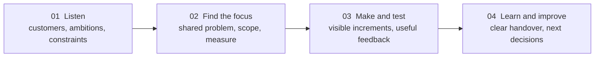
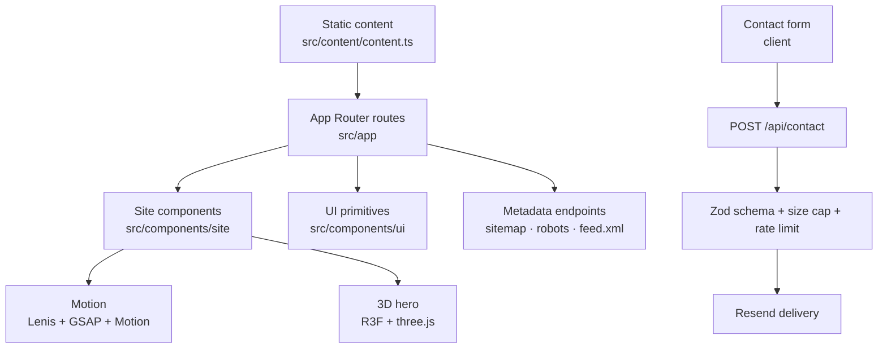
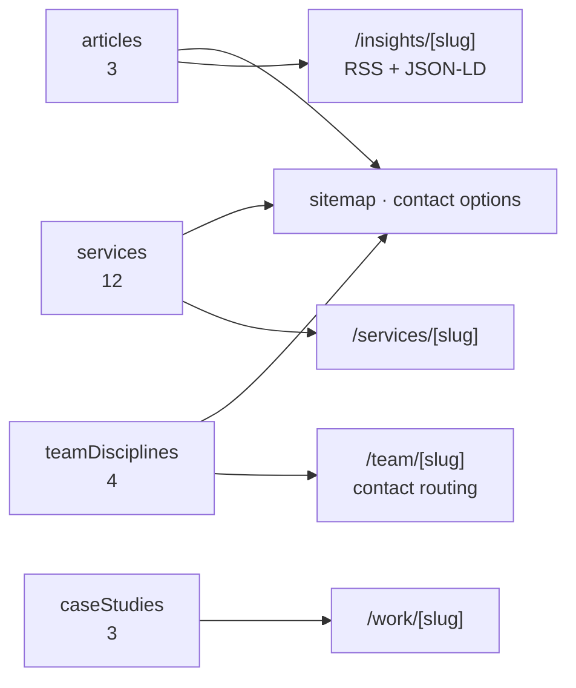
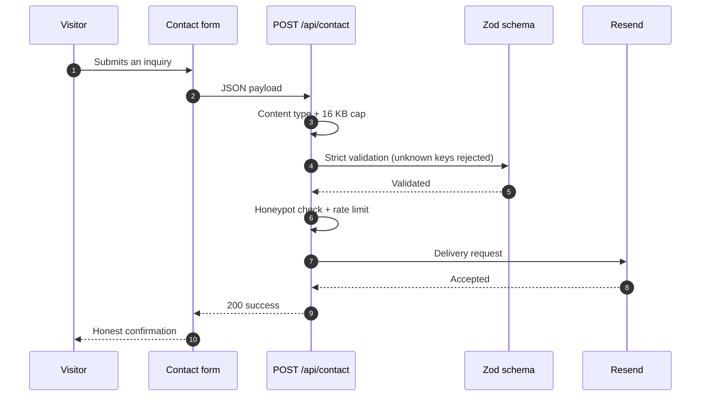

<div align="center">


# BrandUpCrew

**Digital growth & technology independent strategy, design, and engineering for businesses ready to move forward.**


</div>

> **In one line:** this is the public website of an independent digital studio a complete narrative of what the studio does, how it works, and how to start a conversation, built as a static-first Next.js application with one server endpoint.

---

## At a glance

| Field               | Value                                                                         |
| ------------------- | ----------------------------------------------------------------------------- |
| **Studio**          | BrandUpCrew  independent digital studio                                      |
| **Product**         | Public marketing website, production-facing                                   |
| **Framework**       | Next.js 16 · App Router · React Server Components · Turbopack                 |
| **Language**        | TypeScript 5.9 in `strict` mode                                               |
| **Styling**         | Tailwind CSS v4 over a semantic CSS token layer                               |
| **Content**         | One typed module  no CMS, no database                                        |
| **Server API**      | A single route: `/api/contact`                                                |
| **Motion**          | Lenis · GSAP + ScrollTrigger · Motion · React Three Fiber (divided ownership) |
| **Accessibility**   | WCAG 2.2 A/AA checks on representative routes via axe                         |
| **Test engines**    | Chromium · Firefox · WebKit                                                   |
| **Generated pages** | 12 services · 3 concepts · 3 articles · 4 team profiles                       |
| **License**         | [Proprietary  All Rights Reserved](LICENSE.md)                               |

---

## Reading paths

Different visitors need different things from this repository. Start where you are.

| If you are…              | Read in this order                                                                                                                                          |
| ------------------------ | ----------------------------------------------------------------------------------------------------------------------------------------------------------- |
| **A prospective client** | [About the studio](#about-the-studio) → [Service disciplines](#service-disciplines) → [How we work](#how-we-work) → [Studio principles](#studio-principles) |
| **A designer**           | [Design language](#design-language) → [Motion, 3D, and theming](#motion-3d-and-theming) → [`docs/design-system.md`](docs/design-system.md)                  |
| **An engineer**          | [Architecture at a glance](#architecture-at-a-glance) → [Getting started](#getting-started) → [Testing](#testing) → [`CONTRIBUTING.md`](CONTRIBUTING.md)    |
| **A security reviewer**  | [Contact and inquiry pipeline](#contact-and-inquiry-pipeline) → [Deployment notes](#deployment-notes) → [`SECURITY.md`](SECURITY.md)                        |

---

## Contents

- [About the studio](#about-the-studio)
- [What this repository contains](#what-this-repository-contains)
- [Service disciplines](#service-disciplines)
- [Industries we work with](#industries-we-work-with)
- [How we work](#how-we-work)
- [Studio principles](#studio-principles)
- [Design language](#design-language)
- [Technology stack](#technology-stack)
- [Architecture at a glance](#architecture-at-a-glance)
- [Content model](#content-model)
- [Motion, 3D, and theming](#motion-3d-and-theming)
- [Accessibility, performance, and SEO](#accessibility-performance-and-seo)
- [Getting started](#getting-started)
- [Environment variables](#environment-variables)
- [Available scripts](#available-scripts)
- [Quality gates](#quality-gates)
- [Testing](#testing)
- [Project structure](#project-structure)
- [Contact and inquiry pipeline](#contact-and-inquiry-pipeline)
- [Deployment notes](#deployment-notes)
- [What is deliberately not included](#what-is-deliberately-not-included)
- [Documentation](#documentation)
- [Content, legal, and honesty notes](#content-legal-and-honesty-notes)
- [Contributing](#contributing)
- [License](#license)

---

## About the studio

**BrandUpCrew** is an independent digital studio working across **strategy, design, engineering, and digital marketing**. The studio positions itself as one accountable partner rather than a collection of disconnected suppliers: the same team that understands the business problem also designs, builds, and improves the response to it.

The descriptor used across the product is **“Digital growth & technology”**. The public positioning statement is:

> Independent strategy, design, and technology for businesses ready to move forward.

| Area                                | How the studio works with a client                                                                                                     |
| ----------------------------------- | -------------------------------------------------------------------------------------------------------------------------------------- |
| **Strategy before production**      | Engagement starts from the outcome, constraints, and available evidence  not from a template deliverable.                             |
| **Design and engineering together** | Interfaces are designed with implementation, accessibility, and maintainability in view, so the shipped experience matches the intent. |
| **One senior team**                 | Work is delivered by specialists across full-stack engineering, e-commerce, SEO, and growth, coordinated as a single engagement.       |
| **Honest measurement**              | Meaningful measures are agreed up front, and findings are reported as they are  including when they are inconvenient.                 |
| **Collaboration-ready**             | The studio works alongside internal marketing, design, engineering, and leadership teams, with responsibilities agreed at the start.   |

**A good fit if** you need to improve a digital experience, launch a product, or make your marketing more coherent. Fit is decided by the problem and available capacity, not by company size.

**What the studio does not claim:** no guarantees on rankings, revenue, leads, or advertising returns. Work is scoped, measured, and reported honestly.

---

## What this repository contains

This repository is the **public marketing website** for the studio  a production-grade Next.js application that explains the offering, demonstrates how the studio thinks, and converts interest into a project inquiry.

It is intentionally **static-first**: all editorial content is rendered at build time, and there is no database, authentication layer, admin panel, or CMS. The only API route is the contact endpoint; metadata endpoints (`sitemap.xml`, `robots.txt`, `feed.xml`) are generated from the same typed content.

<details>
<summary><strong>Site areas</strong></summary>

| Area                 | What visitors can explore                                                                                                                                                                |
| -------------------- | ---------------------------------------------------------------------------------------------------------------------------------------------------------------------------------------- |
| **Home**             | An immersive WebGL hero, a lead service panel with supporting disciplines, a connected process rail, industries, the team, latest insights, and FAQs.                                    |
| **Services**         | Twelve service pages, each with the problem it solves, the intended outcome, deliverables, a four-step approach, tools used, and service-specific FAQs.                                  |
| **Work**             | Three labelled demonstration concepts showing how a challenge, strategy, and execution are presented  with an explicit portfolio note that they are not client engagements.             |
| **Industries**       | Six industry perspectives: professional services, technology, health & wellbeing, education, commerce, and nonprofits.                                                                   |
| **Process**          | The studio’s four-step working method: listen, find the focus, make and test, learn and improve.                                                                                         |
| **Team**             | Team cards on the home page plus dedicated profile pages per discipline, covering expertise, technology, services, process, selected projects, and FAQs  each able to route an inquiry. |
| **Insights**         | Articles on digital strategy, technical SEO, design, and practical improvements, exposed both as pages and as an RSS feed.                                                               |
| **Contact**          | A structured inquiry form that can be prefilled with a chosen service and/or team member, plus privacy and terms pages.                                                                  |
| **Machine-readable** | `sitemap.xml`, `robots.txt`, `feed.xml`, canonical URLs, Open Graph metadata, and article structured data.                                                                               |

</details>

<details>
<summary><strong>Route map</strong></summary>

| Route                                      | Purpose                                                                    |
| ------------------------------------------ | -------------------------------------------------------------------------- |
| `/`                                        | Home  the full studio narrative.                                          |
| `/about`                                   | Studio positioning, capabilities, and how the studio thinks.               |
| `/services`                                | Service index across all twelve disciplines.                               |
| `/services/[slug]`                         | Twelve static service detail pages, generated from typed content.          |
| `/work`                                    | Selected demonstration concepts (`/work/[slug]` for each of the three).    |
| `/process`                                 | How the studio runs an engagement.                                         |
| `/industries`                              | Industry-specific perspectives.                                            |
| `/insights`                                | Article index (`/insights/[slug]` for each published article).             |
| `/team/[slug]`                             | Team profile pages, generated from `teamDisciplines`.                      |
| `/contact`                                 | Inquiry form, optionally prefilled via `?service=&team=` query parameters. |
| `/faq`, `/privacy`, `/terms`               | Supporting editorial and legal pages.                                      |
| `/api/contact`                             | The only API route: validated, rate-limited inquiry delivery.              |
| `/feed.xml`, `/sitemap.xml`, `/robots.txt` | Generated metadata endpoints.                                              |
| `loading`, `error`, `not-found`            | Loading, error, and 404 states styled as part of the experience.           |

</details>

---

## Service disciplines

Twelve services, grouped by intent. Each one is a first-class page driven by typed content  not a card that links nowhere.

| Group        | Services                                                                                                                                                                                  |
| ------------ | ----------------------------------------------------------------------------------------------------------------------------------------------------------------------------------------- |
| **Build**    | Web design & development · Custom software development · UI/UX design                                                                                                                     |
| **Brand**    | Branding & visual identity · Content strategy & creation                                                                                                                                  |
| **Grow**     | Search engine optimization · Google Ads & paid search · Meta Ads & paid social · Social media strategy & management · Conversion rate optimization · Digital strategy & growth consulting |
| **Automate** | AI integration & business automation                                                                                                                                                      |

Every service page answers the same questions in the same order: **what problem is being solved → what outcome is expected → what gets delivered → how the work is approached → what tools are used → service FAQs**.

---

## Industries we work with

| Industry                  | Perspective the studio brings                                                                          |
| ------------------------- | ------------------------------------------------------------------------------------------------------ |
| **Professional services** | Make expertise easier to understand, evaluate, and engage with across the digital customer journey.    |
| **Technology**            | Translate complex products into clearer experiences, stronger onboarding, and practical foundations.   |
| **Health & wellbeing**    | Create considered, accessible experiences for people making important decisions about their wellbeing. |
| **Education**             | Help learners and institutions find information, understand options, and complete essential tasks.     |
| **Commerce**              | Improve product discovery and buying journeys while keeping customer needs at the center.              |
| **Nonprofits**            | Make mission, programs, and ways to participate easier to discover and act on.                         |

---

## How we work

The same four-step method is repeated on the site, on the process page, and on every service page  so the promise and the delivery model match.



---

## Studio principles

These principles are encoded in the product itself  if a change contradicts them, the change is wrong.

1. **No fabricated proof.** Demonstration concepts are clearly labelled as concepts, and no organization identity, review, rating, or local-business structured data is invented.
2. **No empty promises.** The FAQ states plainly that rankings, revenue, leads, and advertising returns are not guaranteed.
3. **Reproducible delivery.** Every service page defines the deliverables and the approach before it asks for a conversation.
4. **Useful by default.** The site must remain readable, navigable, and honest without WebGL, without JavaScript-heavy effects, and with reduced motion enabled.
5. **Privacy-conscious contact.** The inquiry endpoint validates, limits, and forwards a message. It does not store leads.
6. **Accessibility is a requirement, not a refinement.** Representative routes are verified against WCAG 2.2 AA in automated checks.

---

## Design language

The interface is a deliberate, token-driven system rather than a set of one-off screens.

| Dimension        | Approach                                                                                                                                                                                                                            |
| ---------------- | ----------------------------------------------------------------------------------------------------------------------------------------------------------------------------------------------------------------------------------- |
| **Tokens**       | Semantic roles (`--background`, `--surface`, `--card`, `--foreground`, `--muted`, `--border`, `--accent`) mapped into Tailwind with `@theme inline`, so components never hard-code palette values.                                  |
| **Theme parity** | Light and dark are the same roles remapped. A before-interactive script applies the saved or system theme with no flash, and `theme-color` follows the active theme.                                                                |
| **Brand accent** | A single orange identity colour carries emphasis, interactive states, and glow. Everything else is neutral surface and typography.                                                                                                  |
| **Typography**   | Self-hosted Montserrat variable font through `next/font`, applied as CSS variables (`--font-manrope`, `--font-newsreader`) for display and body roles.                                                                              |
| **Rhythm**       | Radii, elevation, and easing come from tokens (`--radius-*`, `--shadow-*`, `--glow*`, `--ease-out-soft`, `--ease-out-expo`) so spacing and motion feel consistent across pages.                                                     |
| **Composition**  | Oversized display headings with masked reveals, generous whitespace, gradient and mask artwork, and a restrained use of the accent so it always means something.                                                                    |
| **Brand assets** | The mark (`public/Logo.png`) is referenced once through `siteConfig.logo` and appears in the header, footer, and both loading states; `public/favicon.png` is registered in the root metadata. No CSS-drawn substitute marks exist. |

The complete specification  tokens, breakpoints, motion ownership, and the 3D hero contract  is in [`docs/design-system.md`](docs/design-system.md).

---

## Technology stack

| Layer                  | Choice                                                                                                      |
| ---------------------- | ----------------------------------------------------------------------------------------------------------- |
| **Framework**          | Next.js 16 (App Router, React Server Components, Turbopack)  Node.js **20.9+** required                    |
| **UI runtime**         | React 19, TypeScript 5.9 in `strict` mode                                                                   |
| **Styling**            | Tailwind CSS v4 via `@tailwindcss/postcss` plus a semantic CSS token layer in `src/app/globals.css`         |
| **Typography**         | `next/font` (self-hosted Montserrat variable font)                                                          |
| **Scroll**             | Lenis, driven by the GSAP ticker so one animation clock governs the whole page                              |
| **Scroll motion**      | GSAP 3 + ScrollTrigger via `@gsap/react`                                                                    |
| **Component motion**   | `motion` for reveals, counters, and transitions                                                             |
| **3D**                 | three.js with `@react-three/fiber` and `@react-three/drei`                                                  |
| **Icons**              | `lucide-react`                                                                                              |
| **Primitives**         | `class-variance-authority` + `clsx` + `tailwind-merge`                                                      |
| **Validation**         | Zod 4 for environment variables and the contact payload                                                     |
| **Email delivery**     | Resend REST API (optional)                                                                                  |
| **Linting/formatting** | ESLint 9 (`eslint-config-next` core-web-vitals + TypeScript), Prettier 3 with `prettier-plugin-tailwindcss` |
| **Testing**            | Playwright across Chromium, Firefox, and WebKit, with `@axe-core/playwright` for accessibility              |

---

## Architecture at a glance

Server Components are the default. A Client Component boundary is introduced only where browser state, event handlers, or a client-only API demands it, and that boundary is kept as small as possible.



**Rendering model**

- Every editorial route is **prerendered at build time**; slugs are produced by `generateStaticParams` from typed content.
- The root layout owns the title template, description, Open Graph defaults, canonical origin, theme bootstrap, theme colour, favicon metadata, and the initial-loader gate.
- Three files define the whole shell: the header (sticky navigation + theme toggle), the footer, and the shell that also mounts scroll smoothing, the initial loader, the skip link, and the reading-progress bar.
- Route-level `loading.tsx` reuses the same brand loader as the initial page gate, so navigation and first paint share one identity.

<details>
<summary><strong>Client boundaries that exist, and why</strong></summary>

| Component           | Reason it is a Client Component                                            |
| ------------------- | -------------------------------------------------------------------------- |
| Site header         | Scroll state, mobile menu, pathname-aware active states, escape handling   |
| Theme toggle        | Reads and writes the persisted theme, subscribes to system changes         |
| Contact form        | Controlled fields, validation feedback, fetch lifecycle                    |
| Hero visual wrapper | WebGL capability check, viewport observer, dynamic import of the 3D bundle |
| Motion primitives   | GSAP/Motion timelines, pointer interaction                                 |
| Smooth scroll       | Lenis lifecycle tied to the GSAP ticker                                    |

</details>

---

## Content model

All editorial content lives in a single typed module, `src/content/content.ts`. It is the source of truth for routes, sitemap entries, structured data, and FAQ/insight content  there is no CMS and no database.



| Export            | Type           | Count | Drives                                                             |
| ----------------- | -------------- | ----- | ------------------------------------------------------------------ |
| `services`        | `Service[]`    | 12    | `/services`, `/services/[slug]`, sitemap, contact service options  |
| `industries`      | inline array   | 6     | `/industries`, home industry band                                  |
| `caseStudies`     | `CaseStudy[]`  | 3     | `/work`, `/work/[slug]`, work showcase                             |
| `articles`        | `Article[]`    | 3     | `/insights`, `/insights/[slug]`, RSS feed, article structured data |
| `faqs`            | array          | 5     | `/faq`, home FAQ block                                             |
| `processSteps`    | array          | 4     | `/process`, home process rail                                      |
| `teamDisciplines` | `TeamMember[]` | 4     | home team section, `/team/[slug]`, team inquiry routing            |

Each `TeamMember` carries its own expertise list, grouped technology, services, process, experience, selected projects, FAQs, and an `inquiryService` used to prefill the contact form. A member without a portrait renders an accessible “portrait pending” placeholder instead of a broken image.

---

## Motion, 3D, and theming

Motion responsibilities are **divided, never duplicated**. The full contract is in [`docs/design-system.md`](docs/design-system.md); the summary is:

| Owner                    | Responsibility                                                                        |
| ------------------------ | ------------------------------------------------------------------------------------- |
| **Lenis**                | All scrolling. Ticker driven by GSAP so ScrollTrigger and smooth scroll stay in sync. |
| **GSAP + ScrollTrigger** | Scroll- and pointer-linked timelines: masked headings, parallax, magnetics, reveals.  |
| **Motion**               | Component-level transitions: reveals, staggered groups, counters, marquees.           |
| **React Three Fiber**    | The hero scene only.                                                                  |
| **CSS**                  | Hover states, gradient/mask artwork, and ambient keyframes.                           |

**The 3D hero is defensive by design:**

- Loaded with `next/dynamic` and `ssr: false`, only after a WebGL capability check, and never on small screens.
- A CSS fallback sits underneath at all times, so the composition never looks broken while the bundle loads or without WebGL.
- A quality tier (derived from `hardwareConcurrency`, `deviceMemory`, pointer coarseness, and viewport width) controls DPR, antialiasing, particle count, environment resolution, shadows, and whether the expensive transmission material is used.
- An `IntersectionObserver` pauses rendering once the hero scrolls out of view.

**Theming** is attribute-based: the root element carries `data-theme="light|dark"`, a before-interactive script applies the saved or system theme before paint (no flash), the toggle persists the choice, system-preference changes are honoured while no explicit choice exists, and `theme-color` stays in sync with the active theme.

---

## Accessibility, performance, and SEO

### Accessibility

- Semantic landmarks, a skip link, visible two-pixel focus outlines, and accessible names on every icon-only control.
- Motion is never required to understand content: reduced motion neutralises ambient animation, motion primitives bail out of their timelines, Lenis is replaced by native scrolling, the WebGL canvas switches to on-demand frames, and counters render their final value immediately.
- Representative routes are checked with axe against WCAG 2.2 A/AA tags, and no animation is allowed to block clicks or scrolling.

### Performance

- Static-first rendering: editorial content is prerendered at build time with no runtime data fetching.
- The 3D bundle is split and only fetched in the browser after a capability check, with rendering paused when off-screen.
- Images use `next/image`; decorative artwork stays in CSS.
- Fonts are self-hosted through `next/font` and applied as CSS variables.

### SEO and machine readability

- Root metadata defines `metadataBase`, the title template, description, canonical origin, and Open Graph defaults; routes override with their own values.
- `sitemap.xml` is generated from routes plus services, case studies, articles, and team profiles; `robots.txt` allows crawling but disallows `/api/`.
- Articles emit canonical URLs, publication metadata, Open Graph data, and JSON-LD `Article` structured data.
- The insights feed is published as RSS at `/feed.xml` with a one-hour cache window.

---

## Getting started

**Prerequisites**

- **Node.js 20.9 or newer** (required by Next.js 16)
- npm (the repository ships a `package-lock.json`)
- Optional, for the full test matrix: `npx playwright install --with-deps chromium firefox webkit`

```bash
# 1. Install dependencies
npm install

# 2. Create a local environment file
cp .env.example .env.local

# 3. Start the development server
npm run dev
```

The site runs at `http://localhost:3000`. Contact delivery stays disabled until the three Resend values are provided  the form reports this honestly instead of pretending to send.

---

## Environment variables

Validated at startup by Zod in `src/lib/env.ts`. The three delivery variables must be configured **together or not at all**; a partial configuration fails validation on purpose.

| Variable               | Required                                 | Purpose                                                                       |
| ---------------------- | ---------------------------------------- | ----------------------------------------------------------------------------- |
| `NEXT_PUBLIC_SITE_URL` | No (defaults to `http://localhost:3000`) | Canonical origin used by metadata, sitemap, robots, RSS, and structured data. |
| `RESEND_API_KEY`       | Optional                                 | Resend API key used to deliver inquiries.                                     |
| `CONTACT_FROM_EMAIL`   | Optional                                 | Verified sender identity for inquiry emails.                                  |
| `CONTACT_TO_EMAIL`     | Optional                                 | Destination inbox for inquiries.                                              |

Additional test-time variables: `PLAYWRIGHT_PORT` (server port, default `3000`) and `PLAYWRIGHT_USE_PRODUCTION=1` (run the suite against a production build instead of the dev server).

---

## Available scripts

| Command                         | What it does                                              |
| ------------------------------- | --------------------------------------------------------- |
| `npm run dev`                   | Development server with Turbopack.                        |
| `npm run build`                 | Production build (includes type checking).                |
| `npm run start`                 | Serve the production build.                               |
| `npm run lint`                  | ESLint with Next.js core-web-vitals and TypeScript rules. |
| `npm run typecheck`             | `tsc --noEmit` across the project.                        |
| `npm run format`                | Format the repository with Prettier.                      |
| `npm run format:check`          | Verify formatting without writing.                        |
| `npm test` / `npm run test:e2e` | Playwright end-to-end suite across three browser engines. |

---

## Quality gates

A change is only considered ready when every gate passes.

| Gate                   | What it protects against                                                   |
| ---------------------- | -------------------------------------------------------------------------- |
| `npm run lint`         | Rule violations, framework misuse, and integration mistakes.               |
| `npm run typecheck`    | Type drift between content, components, and route parameters.              |
| `npm test`             | Behaviour, accessibility, overflow, theming, and API-contract regressions. |
| `npm run build`        | Prerender failures, missing metadata, and broken dynamic imports.          |
| `npm run format:check` | Formatting drift across the repository.                                    |

---

## Testing

The suite in `tests/e2e` is behaviour-focused: it asserts what a visitor can see and do, plus the API contract.

| Spec                   | Coverage                                                                                                                                                                                                                                                                                                                                                                                                                                                                       |
| ---------------------- | ------------------------------------------------------------------------------------------------------------------------------------------------------------------------------------------------------------------------------------------------------------------------------------------------------------------------------------------------------------------------------------------------------------------------------------------------------------------------------ |
| `home.spec.ts`         | Hero and primary journeys, showcase placement, loader behaviour on load/reload/navigation, team section, all core route headings, mobile navigation, header control grouping, dark-mode contrast, axe accessibility checks, viewport overflow, hero behaviour below 1000px, internal links and public metadata, security headers, contact API contract (validation, content type, size, URL protocol, honeypot, rate limit, provider failures), 404 handling, RSS and sitemap. |
| `team-profile.spec.ts` | Accessible profile links, portrait placeholders, per-member profile content, canonical URLs, related-member panels, FAQ behaviour, direct load and reload, inquiry routing into the contact form, rejection of unverified member values, unknown-profile 404, layout fit, and theming.                                                                                                                                                                                         |
| `theme.spec.ts`        | System theme detection, toggle persistence, accent token integrity, per-page theme stability, and reset to system preference across every route.                                                                                                                                                                                                                                                                                                                               |

```bash
npm test                             # dev server, all three engines
PLAYWRIGHT_USE_PRODUCTION=1 npm test # validate the production build
PLAYWRIGHT_PORT=3100 npm test        # avoid clashing with a running dev server
```

---

## Project structure

```text
.
├── docs/
│   ├── architecture.md        # Application shape and ownership rules
│   └── design-system.md       # Tokens, motion framework split, 3D contract
├── public/                    # Logo, favicon, and team portraits
├── src/
│   ├── app/                   # Routes, layout, global styles, metadata endpoints
│   │   ├── api/contact/       # The only API route
│   │   └── feed.xml/          # RSS feed route handler
│   ├── components/
│   │   ├── site/              # Shell, navigation, page patterns, forms, motion
│   │   ├── three/             # WebGL hero scene
│   │   └── ui/                # Reusable primitives (Button)
│   ├── config/site.ts         # Brand, navigation, and shared site settings
│   ├── content/content.ts     # Typed editorial content (single source of truth)
│   └── lib/                   # Environment validation, theme, scroll bridge, utilities
├── tests/e2e/                 # Playwright specs
├── AGENTS.md                  # Agent/automation rules for this repository
├── CONTRIBUTING.md            # How to work in this codebase
├── SECURITY.md                # How to report a vulnerability
└── LICENSE.md                 # Proprietary terms
```

---

## Contact and inquiry pipeline

The contact form is the only stateful interaction on the site, and it is hardened deliberately.



<details>
<summary><strong>Controls in place, and the response contract</strong></summary>

| Control           | Detail                                                                                                                               |
| ----------------- | ------------------------------------------------------------------------------------------------------------------------------------ |
| Content type      | Only `application/json` is accepted.                                                                                                 |
| Request size      | Declared length and streamed body are both capped at 16 KB.                                                                          |
| Schema            | Strict object: required name, email, at least one known service, 20–5000 character brief; unknown keys are rejected.                 |
| Honeypot          | A hidden field that must stay empty  bots that fill it are rejected.                                                                |
| Rate limit        | 5 requests per 15 minutes per client, with a `Retry-After` header; keys come from a verified IP.                                     |
| Link safety       | Website values must use HTTP or HTTPS.                                                                                               |
| Routing integrity | Team-member values must match a real discipline before they can influence an email.                                                  |
| Honest failure    | Returns 503 when delivery is not configured, 502 when the provider fails, and never reports success for a message that was not sent. |
| No storage        | Inquiries are not persisted anywhere.                                                                                                |

</details>

---

## Deployment notes

- The application is static-first; the host only needs standard Next.js rendering support for the contact route.
- Provide `NEXT_PUBLIC_SITE_URL` with the real public origin before building, so canonical URLs, the sitemap, robots rules, and the feed point at production.
- The production edge (not the repository) must terminate TLS and add **HSTS** and a **nonce-based Content Security Policy** once the deployment domain and asset policy are confirmed.
- The contact ingress must **overwrite** `X-Real-IP`; the built-in limiter is process-local and is not a distributed production control. Replace it with a shared store if the endpoint runs on more than one instance.
- Live contact delivery with real provider credentials has not been verified in this environment  smoke-test it after configuring Resend.

See [`SECURITY.md`](SECURITY.md) for the full hardening checklist and reporting process.

---

## What is deliberately not included

Absence is a decision here, not an oversight.

| Not included                                | Why                                                                                          |
| ------------------------------------------- | -------------------------------------------------------------------------------------------- |
| Database, authentication, admin panel       | A marketing site needs none of them; leaving them out keeps the attack surface to one route. |
| CMS                                         | Content is typed, reviewed, and versioned with the code.                                     |
| Analytics, advertising, and tracking pixels | Nothing is loaded that identifies visitors. Provider and privacy requirements come first.    |
| Consent tooling                             | There is currently nothing to consent to.                                                    |
| CRM or marketing automation                 | Inquiries are delivered, not stored.                                                         |
| Booking, newsletter, payments               | Out of scope for the studio’s current engagement model.                                      |

---

## Documentation

| Document                                         | Read it for                                                                |
| ------------------------------------------------ | -------------------------------------------------------------------------- |
| [`docs/architecture.md`](docs/architecture.md)   | Application shape, ownership, dependency direction, rendering rules.       |
| [`docs/design-system.md`](docs/design-system.md) | Design tokens, motion framework split, 3D hero contract, page composition. |
| [`CONTRIBUTING.md`](CONTRIBUTING.md)             | Setup, standards, and the definition of done for any change.               |
| [`SECURITY.md`](SECURITY.md)                     | Vulnerability reporting, scope, safe harbour, and hardening requirements.  |
| [`AGENTS.md`](AGENTS.md)                         | Repository rules for automated agents working in this codebase.            |

---

## Content, legal, and honesty notes

- **Portfolio content is fictional.** The projects shown are demonstration concepts that illustrate how a challenge, strategy, and execution are presented. They are not client engagements, and no measured results are claimed.
- **No fabricated identity data.** No organization identity, reviews, ratings, or local-business structured data is invented anywhere in the site.
- **Privacy and terms** describe how information is handled and what a working relationship starts from.
- **Inactive on purpose.** Analytics, booking, consent tooling, CRM, and conversion tracking remain disabled until provider, privacy, and account requirements are defined.

---

## Contributing

This is a private project, but the standards are explicit. Read [`CONTRIBUTING.md`](CONTRIBUTING.md) before opening a change: it defines the setup, the non-negotiables (accessibility, reduced motion, semantic tokens, honest content), the motion ownership rules, and the checks a change must pass.

```bash
npm run lint && npm run typecheck && npm test && npm run build
```

---

## License

**Proprietary  All Rights Reserved.** Copyright © 2026 BrandUpCrew.

This project is **not** open source. Source code is visible for evaluation and reference only. Copying, modifying, deploying, distributing, sublicensing, or selling any part of it requires prior written permission, and the BrandUpCrew name, logo, and other brand assets may not be reused. Third-party dependencies remain under their own licenses.

Read the full terms in [`LICENSE.md`](LICENSE.md).

<div align="center">

**BrandUpCrew  independent strategy, design, and technology for businesses ready to move forward.**

</div>
